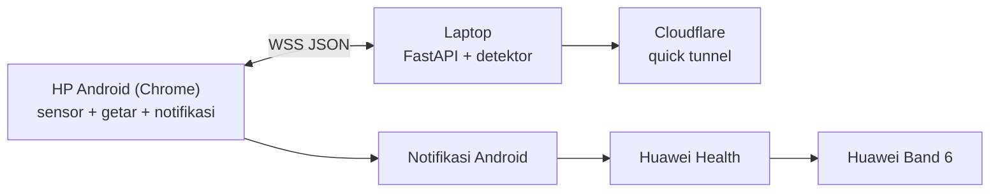

# TasGuard

Sistem pemantauan keamanan tas dan peringatan dini pencurian real-time berbasis sensor
cahaya dan akselerometer. HP Android di dalam tas membaca kecerahan dan getaran; laptop
menjalankan logika `IF terang AND getar THEN alarm`; alarm dikirim ke HP, lalu notifikasinya
diteruskan aplikasi Huawei Health ke Huawei Band 6.

Tidak ada aplikasi yang dipasang di HP. HP hanya membuka alamat web dari laptop di Chrome
Android. Tidak ada Termux, tidak ada broker MQTT, tidak ada CDN atau build step.

## Arsitektur

| Peran | Perangkat | Tugas |
|---|---|---|
| Edge 1 | HP Android + Chrome | Membaca akselerometer dan kecerahan (kamera), mengirim via WebSocket 5 Hz, bergetar + memunculkan notifikasi |
| Edge 2 | Laptop | Server FastAPI: penyedia web app, logika deteksi, pembuat Kode Akses, penyimpanan status |
| Edge 3 | Huawei Band 6 | Menerima notifikasi Android yang diteruskan Huawei Health lewat Bluetooth |
| Tunnel | Cloudflare quick tunnel | Alamat HTTPS publik agar HP bisa memakai data seluler dan sensor tetap berjalan (secure context) |



WebSocket menggantikan broker pub/sub pada rancangan awal: tipe pesan `sensor`, `alarm`,
`control`, dan `state` berperan sebagai topik. Hanya ada satu kanal, yaitu `/ws`.

## Struktur

```
.
├── start.py                 # satu perintah: venv, .env, server, tunnel, QR
├── start.sh / start.bat     # pembungkus untuk Linux/macOS dan Windows
├── server/
│   ├── main.py              # FastAPI: /health, /ws, static web/
│   ├── detector.py          # logika deteksi murni (tanpa WebSocket)
│   ├── config.py            # membaca .env
│   ├── state_store.py       # state.json (armed bertahan setelah restart)
│   ├── requirements.txt
│   └── tools/calibrate.py   # analisis sensor_log.csv
├── web/                     # HTML + CSS + JS biasa, tanpa framework
└── .env                     # dibuat otomatis, berisi ACCESS_KEY (tidak di-commit)
```

## Menjalankan

```bash
python3 start.py
```

Sekali jalan, skrip akan:

1. membuat `.venv` dan memasang dependensi (hanya saat pertama kali atau saat
   `requirements.txt` berubah),
2. membuat `.env` berisi `ACCESS_KEY` acak `secrets.token_urlsafe(24)` bila belum ada,
3. menjalankan server, menunggu `/health` merespons,
4. membuka Cloudflare quick tunnel dan mengambil URL `https://*.trycloudflare.com`,
5. mencetak URL, Kode Akses, dan QR code di terminal.

Pindai QR dengan kamera HP, lalu tekan **Sambungkan** dan **Mulai Pemantauan**.
Kode Akses ikut di fragment URL (`#key=...`), jadi tidak pernah terkirim ke server atau
tercatat di log; web app menghapusnya dari address bar dan menyimpannya di `localStorage`.

Opsi lain:

```bash
python3 start.py --no-tunnel     # hanya server lokal (http://localhost:8000)
python3 start.py --new-key       # buat ulang Kode Akses
python3 start.py --port 8080     # ganti port
```

Port default diambil dari `PORT` di `.env`. Jika port sedang dipakai proses lain, `start.py`
otomatis memilih port kosong berikutnya dan memberi tahu di terminal.

## Protokol (`wss://{host}/ws`, JSON UTF-8)

HP → laptop

| type | contoh | keterangan |
|---|---|---|
| `auth` | `{"type":"auth","key":"...","device_id":"hp-tas-1"}` | pesan pertama, wajib dalam 5 detik |
| `sensor` | `{"type":"sensor","ts":1730000000.123,"light":{"source":"camera","value":12.3},"accel":{"x":0.1,"y":9.7,"z":0.3},"accel_mag":9.71,"battery":87}` | 5 Hz |
| `control` | `{"type":"control","armed":true}` | saklar penjagaan |
| `dismiss` | `{"type":"dismiss"}` | tombol "Saya Sudah Aman" |
| `ping` | `{"type":"ping"}` | keep-alive tiap 5 detik |

Laptop → HP

| type | contoh | keterangan |
|---|---|---|
| `auth_ok` | `{"type":"auth_ok","armed":true}` | autentikasi berhasil |
| `auth_fail` | `{"type":"auth_fail"}` | lalu koneksi ditutup (4001/4003) |
| `state` | `{"type":"state","armed":false}` | konfirmasi perubahan saklar |
| `alarm` | `{"type":"alarm","level":"HIGH","reason":"terang+getar","shake_score":4.2,"trigger_sensor_ts":...,"ts":...}` | perintah getar + notifikasi |
| `pong` | `{"type":"pong"}` | balasan ping |

`GET /health` → `{"status":"ok"}` tanpa data sensitif.

## Konfigurasi `.env`

| Kunci | Default | Arti |
|---|---|---|
| `PORT` | `8000` | port server |
| `ACCESS_KEY` | dibuat otomatis | satu-satunya pengaman akses |
| `LUX_THRESHOLD` | `15` | ambang terang untuk `source=ambient_sensor` (lux) |
| `LUMA_THRESHOLD` | `40` | ambang terang untuk `source=camera` (0-255) |
| `LIGHT_HOLD_MS` | `500` | cahaya harus bertahan selama ini sebelum dianggap terang |
| `ACCEL_THRESHOLD` | `2.5` | deviasi `|accel_mag - 9.81|` dianggap getaran |
| `SHAKE_MIN_SAMPLES` | `3` | jumlah sampel getar minimum dalam 1 detik |
| `COINCIDENCE_WINDOW_S` | `2` | jarak maksimum antara terang dan getar |
| `ALARM_COOLDOWN_S` | `30` | jeda minimum antar alarm |
| `SENSOR_TIMEOUT_S` | `10` | batas diam sebelum alarm `WARN` |
| `LOG_CSV` | `true` | simpan data asli ke `sensor_log.csv` |

Nilai default hanya titik awal dan wajib dikalibrasi (lihat bagian Kalibrasi).

## Keamanan

- Kode Akses dibuat acak, disimpan di `.env` (mode 600), tidak pernah ditulis ke log.
- Autentikasi lewat pesan WebSocket pertama, bukan query string, dibandingkan dengan
  `hmac.compare_digest`.
- Lima percobaan gagal per IP → diblokir 60 detik. IP diambil dari header
  `cf-connecting-ip` jika ada.
- Koneksi baru menggantikan koneksi lama (hanya satu HP aktif).
- Siapa pun yang mengetahui alamat tunnel dan Kode Akses dapat menyambung. Karena itu
  jangan bagikan QR/URL, dan pakai `--new-key` bila bocor.

## Kalibrasi

1. Jalankan server dengan `LOG_CSV=true`, sambungkan HP, lalu mulai pemantauan.
2. Lakukan empat kondisi, masing-masing minimal 30 detik:
   tas tertutup diam, tas dibuka diam, tas tertutup dibawa jalan, tas digoyang.
3. Hentikan pemantauan, lalu jalankan:

```bash
PYTHONPATH=. ./.venv/bin/python3 server/tools/calibrate.py
```

Skrip mencetak min/rata-rata/maks nilai cahaya dan deviasi akselerometer serta menyimpan
saran ambang ke `calibration.json`. Salin nilainya ke `.env`, lalu jalankan ulang server.

## Hasil pengujian

Diisi hanya dari pengujian dengan HP asli. Bagian yang belum diuji ditandai belum diuji.

| Uji | Cara | Hasil |
|---|---|---|
| Autentikasi kode salah | klien WS ke `wss://.../ws` | lolos: `auth_fail` lalu ditutup 4001 |
| Autentikasi kode benar | klien WS ke `wss://.../ws` | lolos: `auth_ok` |
| Blokir 5 percobaan gagal | 6 percobaan berturut-turut | lolos: percobaan ke-6 ditutup 4003 |
| `/health` lewat tunnel | `curl https://.../health` | lolos: `{"status":"ok"}` |
| Ctrl+C mematikan server + tunnel | `kill -INT` pada `start.py` | lolos: uvicorn & cloudflared berhenti, port bebas |
| `start.py` mati mendadak | `kill -9` pada `start.py` | lolos: uvicorn anak ikut berhenti |
| Port sudah dipakai | dua instance bersamaan | lolos: instance kedua pindah ke port 8001 |
| Data sensor asli tampil di Diagnostik | HP asli | **belum diuji** |
| Sumber cahaya yang terpakai di HP | HP asli | **belum diuji** |
| Sensor tetap mengalir saat layar mati / Chrome ke latar | HP asli, 2-3 menit | **belum diuji** |
| Alarm saat tas dibuka + digoyang | HP asli | **belum diuji** |
| Band 6 menerima notifikasi | HP + Band 6 | **belum diuji** |
| Latensi alarm | riwayat di HP | **belum diukur** |

Perkiraan pemakaian data (hitung tangan, bukan hasil ukur): satu pesan sensor ±200 byte
dikirim 5 kali per detik ≈ 1 KB/detik ≈ 3,6 MB/jam, belum termasuk overhead WebSocket
dan keep-alive.

## Panduan Huawei Health (Band 6)

1. HP: **Pengaturan → Aplikasi → Chrome → Notifikasi** → izinkan; atur kategori situs
   web ke "Penting/berbunyi" agar tidak disenyapkan.
2. Huawei Health → **Perangkat → Huawei Band 6 → Notifikasi** → aktifkan saklar utama
   dan centang **Chrome** (serta entri **TasGuard** bila web app dipasang ke layar utama).
3. Izinkan Huawei Health berjalan di latar belakang (baterai: tidak dibatasi).
4. Matikan Mode Jangan Ganggu di HP dan di band.
5. Baterai Chrome: **Tidak dibatasi** agar koneksi tidak diputus sistem.

## Keterbatasan

- Layar HP harus tetap menyala dengan Chrome di depan; browser tidak memberi akses sensor
  dari latar belakang. Perilaku sebenarnya diukur pada pengujian Fase 1.
- Kamera dipakai sebagai pengganti sensor cahaya, jadi nilainya relatif (bukan lux),
  tergantung posisi HP dan auto-exposure, dan wajib dikalibrasi.
- Boros baterai; untuk uji panjang gunakan power bank di dalam tas.
- URL quick tunnel berubah setiap `start.py` dijalankan dan tanpa jaminan uptime.
  Untuk pemakaian stabil perlu named tunnel Cloudflare dengan akun dan domain.
- Laptop harus menyala, online, dan tidak sleep.
- Siapa pun yang tahu Kode Akses dapat menyambung.
- Layar bisa tersentuh tidak sengaja di dalam tas; aktifkan "Pin aplikasi" Android.
- Jangkauan Bluetooth band sekitar 10 m.
- Sistem bergantung pada internet.
- Pencuri bisa mematikan HP.
- Hanya diuji untuk Android + Chrome; iOS tidak didukung karena `navigator.vibrate` tidak ada.

## Troubleshooting

| Gejala | Penyebab & solusi |
|---|---|
| `address already in use` | `start.py` sekarang pindah port otomatis. Bila ingin memakai 8000, hentikan proses lama: `pkill -f "uvicorn server.main:app"`. |
| QR tidak tercetak | Pastikan `qrcode` terpasang di `.venv` (`./.venv/bin/pip install -r server/requirements.txt`). URL tetap bisa dibuka manual. |
| Server langsung berhenti | Lihat pesan error di atas baris `[ERROR]`. `start.py` tidak lagi mencetak URL jika `/health` gagal. |
| Halaman terbuka tapi tidak tersambung | Cek tunnel masih hidup (terminal), lalu pastikan kode akses benar. Setelah 5 kesalahan, tunggu 60 detik. |
| HP tidak mengirim data | Pastikan tombol **Mulai Pemantauan** ditekan, izin kamera diberikan, dan layar tidak mati. |
| Alarm tidak sampai ke band | Ulangi panduan Huawei Health; pastikan notifikasi Chrome tidak disenyapkan. |
